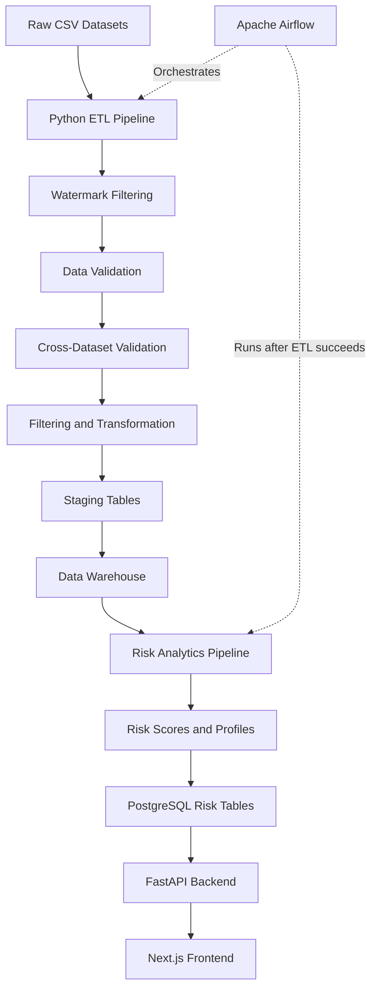
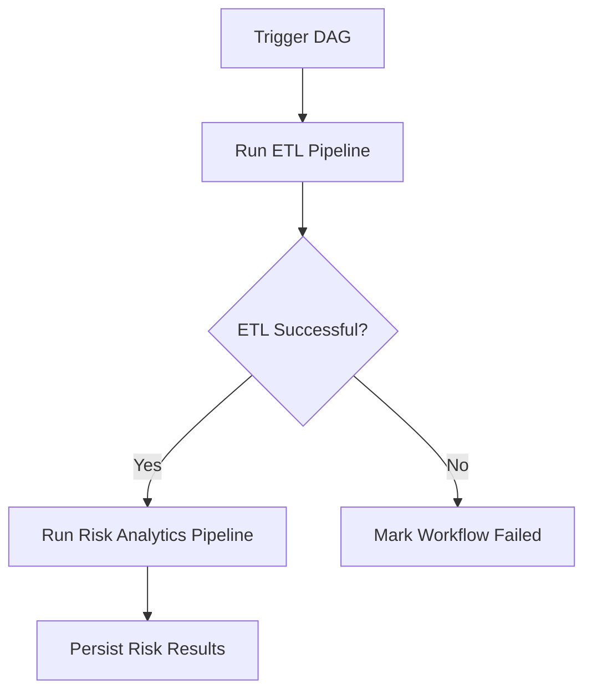

# Risk Analytics ETL Platform

An end-to-end data engineering and risk analytics platform that ingests financial data, validates and transforms raw datasets, and loads structured data into a PostgreSQL data warehouse. The platform processes customer, account, merchant, and transaction data to generate risk analytics at the transaction, account, and customer levels.

Built with Python, PostgreSQL, and Apache Airflow, the project automates the ETL workflow and orchestrates downstream risk analysis. A FastAPI backend exposes the processed analytics through REST APIs, while a Next.js dashboard provides an interactive interface for exploring financial activity, monitoring risk indicators, and visualizing insights derived from the processed data.

The project brings together data quality validation, incremental data processing, warehouse modeling, risk analytics, and dashboard visualization in a single, containerized application.

## Table of Contents

- [Overview](#overview)
- [Key Features](#key-features)
- [Architecture](#architecture)
- [Data Pipeline](#data-pipeline)
- [Risk Analytics Pipeline](#risk-analytics-pipeline)
- [Data Quality and Validation](#data-quality-and-validation)
- [Technology Stack](#technology-stack)
- [Project Structure](#project-structure)
- [Prerequisites](#prerequisites)
- [Configuration](#configuration)
- [Installation and Setup](#installation-and-setup)
- [Running the Pipelines](#running-the-pipelines)
- [Airflow Orchestration](#airflow-orchestration)
- [API Documentation](#api-documentation)
- [Database Design](#database-design)
- [Testing and Troubleshooting](#testing-and-troubleshooting)
- [Future Improvements](#future-improvements)

## Overview

Financial datasets often contain inconsistent values, missing fields, duplicate records, and invalid relationships between entities. An effective analytics platform must address these data quality issues before making the data available for analysis.

This project implements a pipeline that processes four core datasets:

- **Customers** — customer information and identifying attributes.
- **Accounts** — account information and customer relationships.
- **Merchants** — merchant information and classifications.
- **Transactions** — financial transaction records, including amounts, currencies, timestamps, payment methods, and statuses.

The cleaned data is loaded into staging and warehouse layers in PostgreSQL. A downstream risk analytics pipeline then derives transaction risk scores and account/customer risk profiles.

The results are exposed through a FastAPI backend and a Next.js frontend, while Apache Airflow provides orchestration for the ETL and risk analytics workflows.

## Key Features

- **End-to-end ETL:** Extract, validate, filter, transform, and load financial datasets.
- **Incremental processing:** Use watermarks to identify records that need processing rather than blindly reprocessing the entire source dataset.
- **Data quality validation:** Detect missing or invalid values, duplicate identifiers, unexpected columns, and invalid relationships between datasets.
- **Cross-dataset validation:** Check relationships between customers, accounts, transactions, and merchants.
- **Data standardization:** Normalize fields such as names, email addresses, countries, currencies, statuses, and timestamps.
- **Staging and warehouse loading:** Separate incoming processed data from analytical warehouse tables.
- **Risk analytics:** Generate transaction-level risk results and account/customer risk profiles.
- **REST API:** Serve risk analytics data through FastAPI endpoints.
- **Interactive frontend:** Provide a web interface built with Next.js for consuming analytics results.
- **Workflow orchestration:** Use Apache Airflow to execute the ETL pipeline before the risk analytics pipeline.
- **Containerized services:** Run the application services using Docker Compose.

## Architecture

The platform is organized into four main layers:

1. **Data processing:** Python modules handle extraction, validation, filtering, transformation, and loading.
2. **Data storage:** PostgreSQL stores staging data, warehouse tables, and risk analytics outputs.
3. **Orchestration and serving:** Airflow coordinates pipeline execution, while FastAPI exposes the resulting data.
4. **Presentation:** A Next.js frontend consumes the API and presents the analytics.

### High-level workflow



### Service architecture

| Component | Responsibility | Local address |
|---|---|---|
| Next.js frontend | User interface for analytics | `http://localhost:3000` |
| FastAPI backend | REST API for risk analytics | `http://localhost:8000` |
| FastAPI Swagger UI | Explore and test API endpoints | `http://localhost:8000/docs` |
| Airflow webserver | Workflow monitoring and manual DAG triggers | `http://localhost:8080` |
| Main PostgreSQL database | Staging, warehouse, and risk data | `localhost:5432` on the host |
| Airflow metadata database | Airflow's internal metadata | Internal Docker network |

The main PostgreSQL instance is installed directly on the Windows host. Dockerized services access it through `host.docker.internal`. Airflow uses a separate PostgreSQL container for its own metadata.

## Data Pipeline

The ETL pipeline is implemented in `src/pipeline.py`.

### 1. Extraction

The pipeline reads the source datasets for customers, accounts, merchants, and transactions.

The extraction layer provides the raw records for subsequent processing and uses watermarks to support incremental ingestion.

### 2. Watermark filtering

Watermarks help identify records that are new or need to be processed based on the pipeline's configured incremental logic.

This reduces unnecessary processing when working with large datasets. Empty incremental batches must also be handled safely.

### 3. Data validation

The validation layer checks individual datasets for data quality issues, including:

- Missing or invalid required values.
- Duplicate identifiers.
- Invalid field formats and values.
- Unexpected columns.
- Dataset-specific business rules.

Validation results are organized by dataset and include structured error information.

### 4. Cross-dataset validation

The pipeline validates relationships between datasets to prevent inconsistent records from progressing into the warehouse.

Examples include:

- Checking whether an account references a valid customer.
- Checking whether a transaction references a valid account.
- Checking whether a transaction references a valid merchant.
- Checking transaction timestamp constraints.

Where appropriate, validation also considers existing records in PostgreSQL.

### 5. Filtering

Records that fail applicable validation rules are handled by the filtering layer according to the pipeline's rules.

This stage also handles unexpected columns and prepares records for transformation.

### 6. Transformation

The transformation layer standardizes values and prepares datasets for database loading.

Examples include:

- Trimming whitespace and normalizing customer names.
- Converting email addresses to lowercase.
- Standardizing country and currency codes.
- Normalizing account types and statuses.
- Converting timestamp fields into consistent datetime values.
- Rounding monetary values where required.

Transformations are organized by dataset to keep the processing logic maintainable.

### 7. Loading

The loading layer writes processed data to PostgreSQL.

The pipeline separates staging and warehouse loading responsibilities, making it easier to isolate ingestion problems from analytical data-modeling concerns.

The warehouse provides structured data for downstream risk analysis.

## Risk Analytics Pipeline

The risk analytics workflow is implemented in `src/risk_platform/risk_pipeline.py`.

It runs after the ETL pipeline has successfully completed, ensuring that risk analysis uses the latest successfully processed warehouse data.

### Processing stages

1. **Data retrieval:** Fetch transaction and related entity data from the warehouse.
2. **Feature engineering:** Prepare transaction-level features for risk analysis.
3. **Risk scoring:** Calculate risk scores using the project's configured scoring logic.
4. **Entity profiling:** Build account-level and customer-level risk profiles.
5. **Persistence:** Upsert the generated results into PostgreSQL risk tables.

### Risk data outputs

| Output | Purpose |
|---|---|
| `risk.risk_transaction` | Transaction-level risk results |
| `risk.risk_account` | Account-level risk profiles |
| `risk.risk_customer` | Customer-level risk profiles |

The risk outputs are stored separately from the core warehouse data. This separation makes risk analytics available to the API without mixing analytical results with the underlying transaction records.

*Risk scores should be interpreted according to the project's implemented scoring rules. They should not automatically be treated as calibrated probabilities of fraud.*

## Data Quality and Validation

Data quality is a central part of the pipeline rather than an afterthought.

### Validation categories

| Category | Example |
|---|---|
| Completeness | Missing required customer or transaction fields |
| Uniqueness | Duplicate customer, account, or merchant identifiers |
| Format and domain | Invalid country codes, currencies, statuses, or transaction types |
| Referential integrity | An account referencing a nonexistent customer |
| Transaction integrity | A transaction referencing an invalid account or merchant |
| Temporal integrity | Transaction timestamps failing configured validation rules |
| Schema consistency | Unexpected source columns |

### Validation reporting

Validation results can be used to identify the dataset, type, and nature of a data quality issue. The project also includes reporting functionality for producing HTML validation reports.

This makes it easier to investigate rejected records and understand data quality problems before they propagate into downstream analytics.

## Technology Stack

| Technology | Role |
|---|---|
| Python | ETL, validation, transformation, and risk processing |
| pandas | Tabular data processing |
| PostgreSQL | Staging, warehouse, risk outputs, and Airflow metadata |
| SQL | Data retrieval, analytical joins, and database operations |
| Apache Airflow | Workflow orchestration |
| FastAPI | Backend REST API |
| Next.js | Frontend application |
| Docker | Containerization |
| Docker Compose | Local multi-service environment |
| pytest | Automated testing |

## Project Structure

The repository is organized around processing layers and application components.

```text
Risk Analytics ETL/
├── airflow/
│   └── Dockerfile
├── dags/
│   └── risk_analytics_dag.py
├── data/
│   └── raw/
├── frontend/
├── reports/
├── sql/
├── src/
│   ├── pipeline.py
│   ├── extract/
│   ├── validate/
│   ├── filter/
│   ├── transform/
│   ├── load/
│   ├── utils/
│   └── risk_platform/
│       ├── api/
│       │   ├── main.py
│       │   └── routes.py
│       ├── queries/
│       ├── features/
│       ├── scoring/
│       ├── profiling/
│       └── risk_pipeline.py
├── tests/
├── .env.example
├── .gitignore
├── docker-compose.yml
└── README.md
```

## Prerequisites

Install the following tools before running the project:

- Python 3.12 or a compatible version supported by the project's dependencies.
- PostgreSQL installed and running on the Windows host.
- Docker Desktop with Docker Compose.
- Node.js and npm if you intend to run the frontend outside Docker.
- Git.

Make sure Docker Desktop is running before executing Docker Compose commands.

## Configuration

The application uses environment variables for database connectivity and other runtime settings.

Create a local `.env` file from the example configuration if one is provided:

```powershell
Copy-Item .env.example .env
```

Update the local configuration with the values required by your setup. Keep credentials and other secrets out of version control.

### PostgreSQL configuration

The project uses two PostgreSQL instances for different purposes:

**Main application database**

- Installed directly on the Windows host.
- Stores staging, warehouse, and risk analytics data.
- Accessible from Docker containers through `host.docker.internal:5432`.

**Airflow metadata database**

- Runs as a separate Docker Compose service.
- Stores Airflow metadata, including DAG runs, task states, and scheduling information.
- Is not a replacement for the main application database.

Before running the pipelines, verify that the main database exists, the configured user has the necessary permissions, and the required schemas and tables have been created.

Do not publish real database passwords, API keys, or other sensitive values in the README or commit them to Git.

## Installation and Setup

### 1. Clone the repository

```powershell
git clone <(https://github.com/danishRasheed19/fintech-risk-analysis-etl)>
cd "Risk Analytics ETL"
```

Replace the placeholder URL with the repository's actual GitHub URL.

### 2. Configure the environment

Create and edit your local `.env` file as described in the [Configuration](#configuration) section.

Ensure that the database settings used by the backend, ETL pipeline, and risk pipeline match your local PostgreSQL configuration.

### 3. Start PostgreSQL

Start the PostgreSQL service installed on Windows and confirm that it is listening on the configured port.

The Dockerized backend and Airflow services must be able to reach the host database using `host.docker.internal`, rather than `localhost`.

### 4. Start the application stack

From the project root, run:

```powershell
docker compose up -d --build
```

This builds and starts the configured Docker services.

Check the status of the containers:

```powershell
docker compose ps
```

### 5. Access the services

Once the services have started successfully, use:

- Frontend: `http://localhost:3000`
- Backend API: `http://localhost:8000/docs`
- Airflow: `http://localhost:8080`

For the local development Airflow configuration, the intended login is `airflow` / `airflow`. Change development credentials before using the system in any shared or production environment.

Airflow may take some time to initialize its metadata database and start the webserver.

## Running the Pipelines

### Run the ETL pipeline

From the project root, activate the Python environment containing the project's dependencies and execute:

```powershell
python src/pipeline.py
```

The pipeline processes the configured source datasets and loads the resulting data into PostgreSQL.

### Run the risk analytics pipeline

After the ETL pipeline succeeds, execute:

```powershell
python src/risk_platform/risk_pipeline.py
```

This retrieves the relevant warehouse data, calculates risk results, builds entity profiles, and writes the outputs to the configured risk tables.

### Run both pipelines manually

The intended order is:

```text
ETL pipeline
    |
    v
Risk analytics pipeline
```

The risk pipeline should not run against stale or incomplete warehouse data when the ETL pipeline has failed.

### Run the application through Docker

To rebuild and restart the configured services after code or dependency changes:

```powershell
docker compose up -d --build
```

To inspect the service logs:

```powershell
docker compose logs --tail=100
```

To inspect one service:

```powershell
docker compose logs --tail=100 backend
```

Use the actual Compose service names if they differ from these examples.

To stop the services:

```powershell
docker compose down
```

This stops and removes the Compose containers and network. Named volumes are retained unless explicitly removed.

## Airflow Orchestration

The project includes an Airflow DAG named `risk_analytics_pipeline`, defined in `dags/risk_analytics_dag.py`.

The DAG contains two sequential tasks:

1. **ETL task:** Executes `src/pipeline.py`.
2. **Risk task:** Executes `src/risk_platform/risk_pipeline.py` after the ETL task succeeds.

The DAG is configured for manual execution rather than a recurring schedule.

### Workflow



### Running the DAG

1. Start the Docker Compose stack.
2. Open `http://localhost:8080`.
3. Sign in with the configured local Airflow credentials.
4. Find `risk_analytics_pipeline`.
5. Trigger the DAG manually.
6. Inspect task states and logs to diagnose failures.

The DAG's dependency ensures that the risk analytics task only executes after the ETL task completes successfully.

Airflow's metadata database and logs are managed separately from the main application's PostgreSQL data.

## API Documentation

The backend is implemented with FastAPI.

Open the Swagger UI to inspect the available endpoints, review their parameters, and test requests:

**[Open API documentation](http://localhost:8000/docs)**

The backend exposes risk analytics data sourced from PostgreSQL. The frontend uses the backend API to retrieve and present this data.

For local development, ensure that the API's database configuration is correct and that the relevant risk tables have been populated before testing endpoints that depend on processed results.

## Database Design

The database separates operational ingestion, analytical warehouse data, and derived risk results.

### Staging layer

Stores incoming processed datasets before or during their warehouse-loading process. This layer supports ingestion and data quality workflows.

### Warehouse layer

The warehouse includes fact and dimension tables used for analytical queries.

| Table | Purpose |
|---|---|
| `warehouse.fact_transaction` | Transaction facts used for analysis |
| `warehouse.dim_account` | Account attributes |
| `warehouse.dim_customer` | Customer attributes |
| `warehouse.dim_merchant` | Merchant attributes |

The fact table joins to the dimension tables to provide the contextual data required for risk feature engineering.

### Risk layer

The risk schema stores derived analytics:

- `risk.risk_transaction`
- `risk.risk_account`
- `risk.risk_customer`

Separating these outputs allows the application to query risk results independently from the raw ingestion and core warehouse layers.

## Testing and Troubleshooting

### Run automated tests

If the project's test dependencies are installed, run:

```powershell
python -m pytest
```

### Check Docker services

```powershell
docker compose ps
docker compose logs --tail=100
```

If a service fails to start, inspect its logs before rebuilding or removing containers.

### Backend cannot connect to PostgreSQL

When the backend runs inside Docker, `localhost` refers to the backend container itself, not the Windows host.

Use `host.docker.internal` for the main PostgreSQL server installed on Windows. Also verify the PostgreSQL port, credentials, database name, and host authentication settings.

### Airflow is unavailable

Check the webserver, scheduler, and metadata database:

```powershell
docker compose ps -a
docker compose logs --tail=100 airflow-webserver
docker compose logs --tail=100 airflow-scheduler
docker compose logs --tail=100 airflow-db
```

Confirm that the Airflow metadata database is healthy and that the webserver finishes starting. If the webserver repeatedly times out, inspect Docker resource usage and the webserver logs.

### Airflow DAG does not appear

Check that `dags/risk_analytics_dag.py` is mounted into the Airflow container and that the DAG file has no import errors.

Inspect the scheduler logs:

```powershell
docker compose logs --tail=100 airflow-scheduler
```

### ETL pipeline fails on imports

Run the ETL script from the repository root so that its expected paths and imports resolve correctly:

```powershell
python src/pipeline.py
```

When running it through Airflow, verify that the project source directory is mounted and included in the container's Python import path.

### No new records are processed

Incremental processing may legitimately produce an empty batch when no records are newer than the stored watermark. Check the watermark logic, source data, and database state before treating an empty batch as a failure.

### API returns empty results

Confirm that the ETL and risk analytics pipelines completed successfully and that the expected warehouse and risk tables contain data. Then verify the API's database configuration and query filters.

## Future Improvements

Potential next steps for the platform include:

- Automated and configurable scheduling of ETL workflows.
- Enhanced analytics and features for the dashboard.
- More comprehensive unit, integration, and end-to-end tests.
- Improved data quality metrics and validation-report summaries.
- Stronger pipeline observability, structured logging, and alerting.
- Additional risk indicators and historical risk trend analysis.
- Database migration management and reproducible environment setup.
- CI workflows for automated testing and code quality checks.
- Better secrets management, authentication, and deployment configuration.

